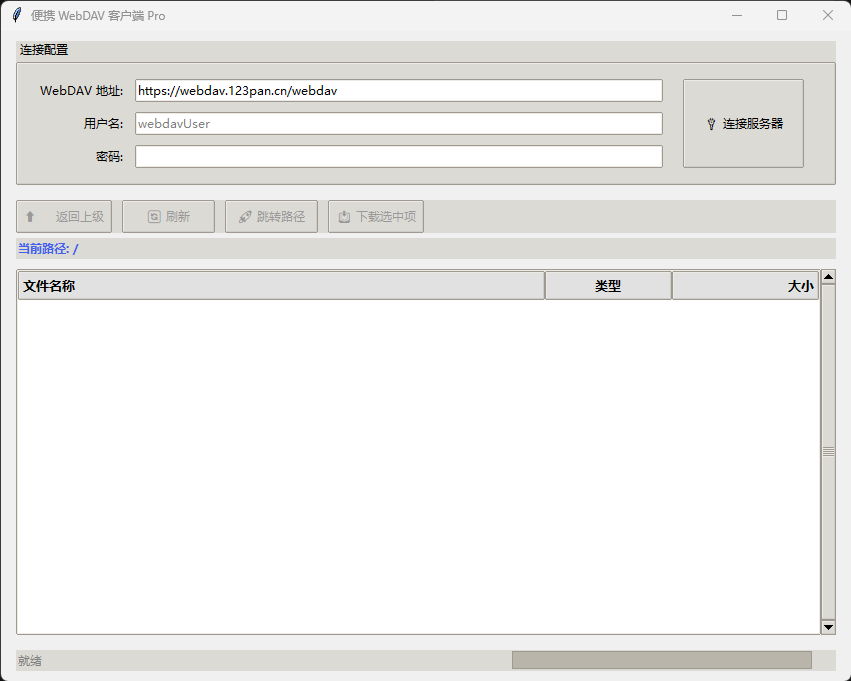

# 🚀 Portable WebDAV Client (便携 WebDAV 客户端)



一个基于 Python + Tkinter 开发的轻量级、便携式 WebDAV 客户端。支持快速连接 WebDAV 服务器（如 123 云盘、坚果云、AList 等），提供直观的可视化界面进行文件浏览、下载与上传。

## ✨ 核心特性

- **🧳 绿色免安装**：提供打包好的单文件可执行程序，不写注册表、不留系统垃圾，放进 U 盘插上就能用。
- **🎈 极致轻量**：纯 Python 编写，运行资源占用极低，老电脑也能流畅运行。
- **🖥️ 现代 UI**：采用 `ttk` 扁平化主题，支持 Treeview 多列文件列表、Emoji 图标与 Windows 高 DPI。
- **🖱️ 便捷交互**：
  - 双击进入文件夹 / 提示并下载文件。
  - 右键菜单（下载、上传、复制名称、复制完整路径、刷新）。
  - 路径历史记录、返回上级、绝对路径一键跳转。
  - 点击表头按名称 / 类型 / 大小排序，文件夹始终置顶。
- **📥 智能下载**：后台线程下载，实时显示进度与网速；先写 `.part` 临时文件再原子替换，取消或失败不会破坏本地同名旧文件。
- **⏯️ 断点续传（下载）**：自动保留 `.part` 断点，使用 `Range` + `If-Range` 从断点继续；远端文件变化时自动从头下载。
- **📤 稳定上传**：流式上传并显示真实进度与网速，单文件上限 2 GB；上传过程中可随时取消。
- **🌐 网络选项**：支持 HTTP/HTTPS/SOCKS5 代理与自定义 CA 证书（PEM/CRT）。
- **🧵 不卡界面**：目录加载、下载、上传均在后台线程执行，并通过请求令牌避免快速切换目录时旧结果覆盖新目录。
- **🔒 隐私安全**：账号密码仅在内存中流转，不生成任何本地配置文件，用完即关。

## ⌨️ 快捷键

| 快捷键 | 功能 |
| --- | --- |
| `F5` | 刷新当前目录 |
| `Enter` | 打开选中项 |
| `Backspace` | 返回上级目录 |
| `Ctrl + C` | 复制选中文件名 |
| `Ctrl + Shift + C` | 复制选中文件完整路径 |

## ⏯️ 断点续传与传输取消

**下载续传**：下载时先写入同目录下的 `文件名.part`。取消、断网或关闭程序后，断点会保留；再次下载到同一路径时自动发送 `Range` 请求续传，并用 `If-Range`（ETag / Last-Modified）校验远端文件是否变化。若服务器不支持 Range 或文件已变化，会自动从头下载。想强制重新下载时，删除对应的 `.part` 文件即可。

**上传取消**：上传过程中工具栏的“下载选中项”会变成“取消上传”，点击并确认后会中断当前 HTTP PUT。

**为什么上传不能像下载一样断点续传？** 标准 WebDAV 的 `PUT` 是原子替换整个资源，RFC 7231 要求服务器拒绝带 `Content-Range` 的 `PUT`，因此通用 WebDAV 没有字节级续传。真正的上传续传依赖服务器私有协议，例如 Nextcloud/ownCloud 的 chunked upload（先 `MKCOL` 创建上传目录、分块 `PUT`、最后 `MOVE` 合并）。本程序目前对所有服务器统一使用整文件上传 + 可取消，不做不可靠的“伪续传”。

## 🌐 代理与自定义 CA

- **代理**：在“代理(可选)”中填写 `http://127.0.0.1:7890` 或 `socks5://127.0.0.1:1080`。留空时跟随系统环境变量（`HTTP_PROXY` / `HTTPS_PROXY`）。SOCKS5 依赖 `PySocks`，已包含在 `requirements.txt` 中。
- **自定义 CA**：点击“浏览...”选择 PEM/CRT 证书文件，适用于自签名证书或企业内网 HTTPS 中间人代理。
- 代理与 CA 只在当前进程内使用，不写入配置文件；账号密码同样不落盘。

## 🪟 Windows 7 兼容性

**结论：程序代码兼容 Python 3.8，并已提供 Win7 专用构建；但当前环境无法做真实 Win7 实机回归，建议先在目标机器上验证。**

- Win7 用户请下载文件名带 `Win7` 的包：
  - 64 位：`Portable_WebDAV_Client_Win7_Windows7_X64.exe`
  - 32 位：`Portable_WebDAV_Client_Win7_Windows7_X86.exe`
- 普通的 `Windows_X64/X86` 构建使用 Python 3.9，而 Python 3.9 官方最低要求 Windows 8.1，**不能在 Win7 上运行**。
- Win7 构建使用 Python 3.8.10 + PyInstaller 6.x；Python 3.8 是最后一个官方支持 Win7 的版本。PyInstaller 官方运行环境要求 Win8+，对 Win7 目标仅表示 “should work”，因此 Win7 包属于尽力兼容，建议实机验证。
- 系统要求：Windows 7 SP1，并建议安装：
  - KB2999226（Universal C Runtime，缺少时通常报 `api-ms-win-crt-*.dll` 缺失）
  - KB2533623（Python 3.8 需要的 `AddDllDirectory` API）
  - KB3140245 等 TLS 1.2 相关更新（部分 HTTPS 服务器需要）
  - KB4474419、KB4490628（SHA-2 代码签名支持）
- Nuitka 标准版官方面向 Windows 10+；Win7 请使用 PyInstaller 的 Win7 包，或使用 Nuitka Commercial 的 Legacy Windows 构建。
- Win7 没有彩色 Emoji 字体，程序会自动退化为纯文字按钮，不影响功能。
- Windows 7 与 Python 3.8 均已停止官方支持，仅建议用于无法升级的老设备或内网环境。

## 📦 如何使用（普通用户）

如果你不想配置 Python 环境，可以直接下载打包好的便携版可执行文件：

1. 前往本项目的 [Releases 页面](https://github.com/jiu-zui-90817/Portable-WebDAV-Client/releases)。
2. 下载最新的可执行文件（PyInstaller 或 Nuitka 版本均可）；Windows 7 请选择文件名带 `Win7` 的包。
3. 双击直接运行，无需安装。

## 🛠️ 如何开发 / 运行源代码

要求 Python 3.9+（代码本身兼容 3.8；Windows 7 构建固定使用 Python 3.8.10）。

**1. 克隆项目**

```bash
git clone https://github.com/jiu-zui-90817/Portable-WebDAV-Client.git
cd Portable-WebDAV-Client
```

**2. 安装依赖**

```bash
python -m pip install -r requirements.txt
```

Linux 还需要系统自带的 tkinter（Debian/Ubuntu）：

```bash
sudo apt-get install -y python3-tk
```

**3. 启动**

```bash
python portable_webdav_client_Pro.py
```

**4. 运行测试**

```bash
python -m unittest discover -s tests -t . -v
```

## 📦 自行打包

**PyInstaller**

```bash
pip install pyinstaller
pyinstaller --onefile --noconsole --name Portable_WebDAV_Client ^
  --icon=webdav.ico --add-data "webdav.ico;." portable_webdav_client_Pro.py
```

**Nuitka**

```bash
pip install nuitka
python -m nuitka --onefile --enable-plugin=tk-inter ^
  --windows-disable-console --windows-icon-from-ico=webdav.ico ^
  --include-data-file=webdav.ico=webdav.ico ^
  portable_webdav_client_Pro.py
```

> Linux / macOS 下把 `^` 换成 `\`，并把 `;` 换成 `:` 即可。

**Windows 7 专用包**

```powershell
py -3.8-32 -m venv .venv-win7
.venv-win7\Scripts\pip install -r requirements-win7.txt pyinstaller==6.18.0
.venv-win7\Scripts\pyinstaller --onefile --noconsole --name Portable_WebDAV_Client_Win7 --icon=webdav.ico --add-data "webdav.ico;." --hidden-import=socks portable_webdav_client_Pro.py
```

> 64 位 Win7 请把 `-3.8-32` 换成 `-3.8` 并使用 64 位 Python。CI 中的 `build-win7` 会自动产出两个架构。

## 📁 项目结构

```text
Portable-WebDAV-Client/
├── portable_webdav_client_Pro.py   # 主程序（单文件实现）
├── requirements.txt                # Python 依赖
├── requirements-win7.txt           # Win7 / Python 3.8 专用依赖锁
├── tests/                          # 不依赖窗口的纯逻辑单元测试
├── assets/screenshot.png           # README 截图
├── webdav.ico                      # 程序图标
└── .github/workflows/build.yml     # 多平台自动构建与 Release
```

## ❓ 常见问题

- **连接 123 云盘 / AList 失败？** 先确认 WebDAV 地址、用户名与密码（部分服务使用单独的 WebDAV 应用密码）。
- **上传按钮不可用？** 连接成功且目录加载完成后才会启用；国内网盘的真实写权限在上传时由服务端校验。
- **Linux 启动报 `No module named tkinter`？** 安装 `python3-tk` 后重试。
- **打包后窗口没有图标？** 确认打包时通过 `--add-data`（PyInstaller）或 `--include-data-file`（Nuitka）带上了 `webdav.ico`。
- **下载目录里出现 `.part` 文件？** 这是断点文件，保留可续传；删除后下次会从头下载。
- **SOCKS5 代理报缺少依赖？** 执行 `pip install PySocks` 后重试。
- **Win7 双击没反应或提示缺少 DLL？** 确认使用带 `Win7` 的构建包，并安装 KB2999226（UCRT）与 KB2533623。
- **Win7 上按钮图标变成方块？** 这是 Win7 字体限制；程序已自动退化为纯文字，不影响功能。

## 🔐 安全说明

用户名和密码只保存在当前进程内存中，程序不会写入配置文件、注册表或日志。关闭窗口后即释放。

## 📄 License

本项目基于 [LICENSE](LICENSE) 开源。
